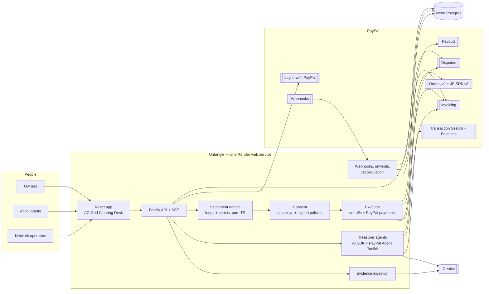
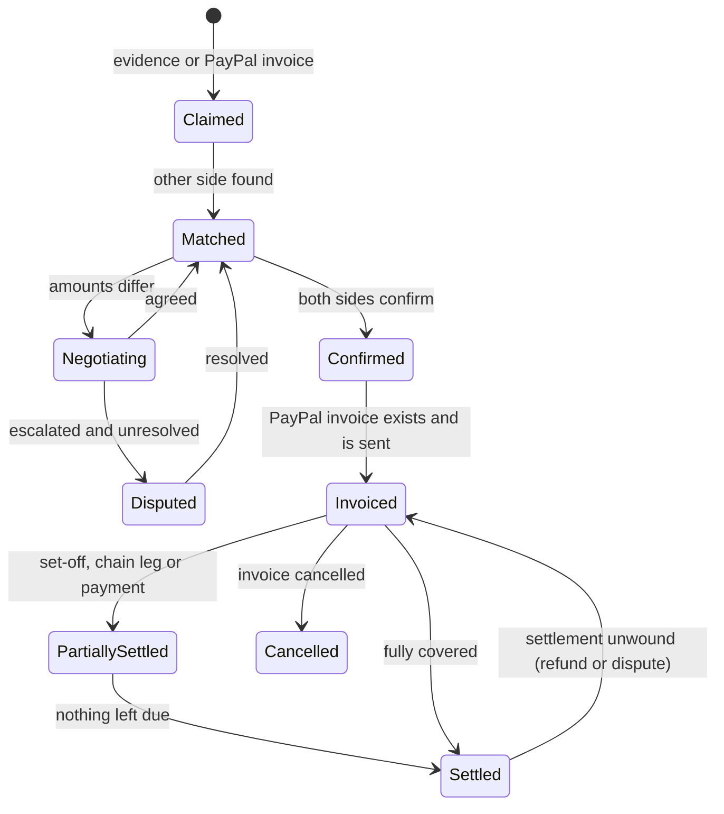
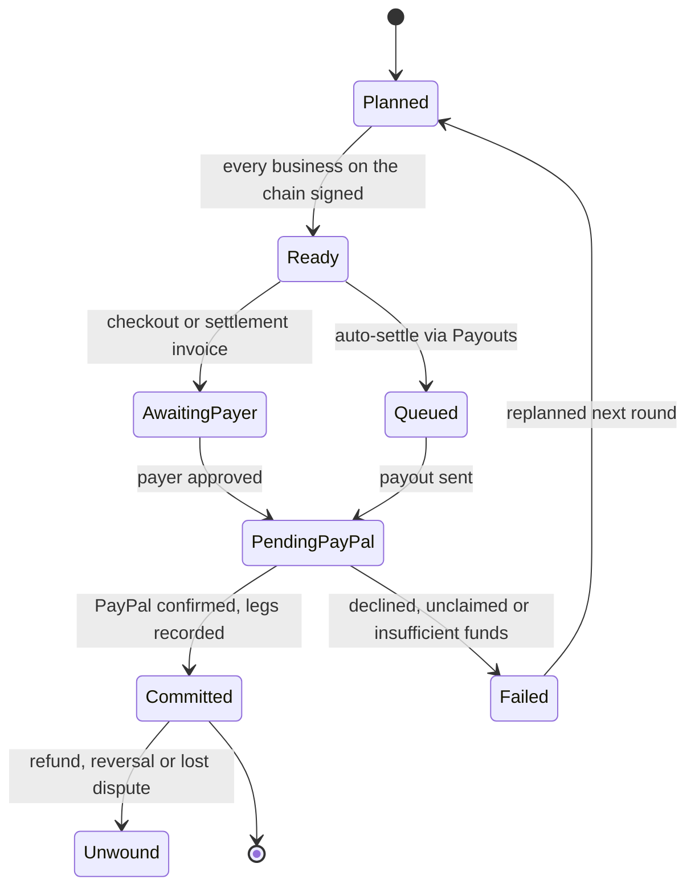

# Untangle: Architecture v1

> **AI finds every debt between small businesses. Debts that run in a loop cancel out with no money. PayPal moves the smallest amount possible, and a single PayPal payment can pay off a whole chain of debts.**

| | |
|---|---|
| Event | PayPal AI Hackathon 2026 (Devpost) |
| Sponsor prize we are targeting | AG Grid (Best Use of AG Grid) |
| Runs on | One Render web service, Neon Postgres, Gemini (free tier), PayPal sandbox |
| Cost | $0 |
| Status | Design. No code yet. |

---

## 1. Principles

1. **PayPal is the settlement layer.**
   - Every debt lives as a PayPal invoice.
   - Every movement of money is a PayPal payment.
   - Every settlement is written back onto the PayPal invoices, together with the PayPal transaction that caused it.
2. **Move the least money possible.**
   - Debts that run in a loop cancel with no money at all.
   - Everything else is settled with the fewest PayPal transfers.
   - No business pays more than its net debt.
3. **Untangle never holds money.** PayPal moves funds directly between businesses. Untangle only computes, collects signatures and records.
4. **AI proposes, math decides, owners sign, PayPal executes.** No model can move money.
5. **PayPal events are the commit points.** A chain counts as settled only when PayPal confirms the payment. A refund or dispute reverses it automatically.
6. **Everything leaves a verifiable trail.**
   - The event log is append-only and hash-chained.
   - Consents are signed.
   - Consent hashes are written into the notes on PayPal invoices.
7. **Built for free tiers, shaped for production.** One service, serverless Postgres and no polling. Each piece of infrastructure sits behind an interface that can be swapped later.

---

## 2. How PayPal is used

| PayPal product | Job in Untangle | Why we can't do without it | Demo moment |
|---|---|---|---|
| **Invoicing API** | The record of every debt. We create, send, search, remind, record payments, delete external payments, and generate QR codes. | Cancelled and settled debts are written onto real PayPal invoices. That gives businesses a shared record they can both trust. | Invoices flip to `MARKED_AS_PAID`, `PARTIALLY_PAID` or `PAID`, with Untangle's references visible inside PayPal. |
| **Orders v2 + JS SDK v6** | "Pay my net": a debtor approves one PayPal payment to the business at the end of its chain. | This is the payment that settles a chain. | The owner taps the PayPal button. One capture settles four invoices across four businesses. |
| **Payouts** | Auto-settle: a business's treasurer agent pays its net debt to several creditors in one batch, under a policy the owner signed. | A push-payment rail that agents can use for business-to-business transfers with several recipients. | Friday settlement runs by itself. Each payout succeeds and its chain closes. |
| **Webhooks** | Signals to commit or undo: events for invoices, captures, payout items and disputes. | Chains are only committed once PayPal confirms the payment. | The live grid flips within seconds of PayPal's confirmation. |
| **Payments v2** | Capture details for evidence, and handling refunds. | This is how a settlement gets reversed. | — |
| **Disputes API** | If a settlement payment is disputed, we submit the signed chain record as evidence. | Protection follows the money. | "Disputed? Here is every signature, hash and PayPal ID." |
| **Transaction Search + Balances** | Agents read the business's history (to find trading partners and choose timing) and its balance ("can I pay my net?"). Also used for daily reconciliation. | This is both the AI's input and the audit's source of truth. | "Your PayPal history shows 5 trading partners." |
| **Log in with PayPal** | Verifies a business's identity when it joins a network. | Only verified PayPal businesses can enter loops. | "Join with PayPal." |
| **Agent Toolkit (MCP)** | The treasurer agents' PayPal tools: invoices, orders, transactions and disputes. Each agent can only use its own business's token. | PayPal's own AI tooling is how the agents see and act. | The agent says: "I read your last 90 days in PayPal…" |
| **Guest invoice payment** | Businesses without PayPal receive PayPal invoices they can pay by card. | Growth: informal debts become PayPal invoices, and the other party becomes a PayPal user. | The cash-only trucker pays by card and gets invited to PayPal. |

**Why PayPal benefits:**
- Small-business settlement moves onto PayPal. Today it mostly happens by cheque, bank transfer or cash, or not at all.
- PayPal Invoicing becomes the shared ledger of a local economy.
- Every informal debt with a business that isn't on PayPal turns into a PayPal invoice and a likely sign-up.
- Buyer and seller protection still applies. A settlement can be disputed through PayPal, backed by a cryptographic evidence pack.
- Clearing could be a paid PayPal service, so PayPal earns revenue on settlement and not only on volume.

---

## 3. The settlement math

The input is the set of confirmed debts, drawn as a graph: each edge points from debtor to creditor and carries the amount outstanding.

1. **Loops cancel.**
   - We use multilateral trade-credit set-off (MTCS). Slovenia's national clearing system has run this method monthly since at least 2016, covering 80,124 firms in the 2016–2025 data.
   - It finds the largest circular flow inside the debt graph and cancels it.
   - Every business receives as much as it gives up, so nobody's net position changes.
   - These cancellations are recorded on the PayPal invoices as set-offs. No money moves.
2. **Chains settle through PayPal.**
   - Once loops are removed, what remains has no cycles.
   - We split it into paths that run from businesses who owe overall (net debtors) to businesses who are owed overall (net creditors).
   - Each path becomes **one PayPal payment**, from the first business on the path to the last.
   - Each business in the middle has the debt owed to it, and the debt it owes, both paid off by that same amount. This works by signed assignment: the middle business hands over its right to be paid.
3. **It is provably the least money possible.**
   - The money moved through PayPal equals the sum of all net debts.
   - No settlement can use less, because every net creditor has to receive its net position in real money.
   - No business pays more than its own net debt.
4. **We keep the number of payments small.**
   - Paths that share the same payer and payee are merged.
   - A greedy "longest path first" split keeps the payment count low. Finding the exact minimum is computationally intractable (NP-hard), and the greedy approach is good enough.

**A three-business example**

Starting debts:
- Bakery owes Mill $3,000.
- Mill owes Trucker $2,400.
- Trucker owes Bakery $2,800.

Step 1: the loop clears $2,400. What remains:
- Bakery owes Mill $600.
- Trucker owes Bakery $400.

Each business's net position after that:
- Bakery is −$200 (it owes $600 and is owed $400).
- Mill is +$600.
- Trucker is −$400.

Step 2: the chains settle.
- Chain Trucker → Bakery → Mill, for $400: **one PayPal payment of $400 from Trucker to Mill.** It pays off Trucker's $400 to Bakery and $400 of Bakery's debt to Mill.
- Chain Bakery → Mill, for $200: one PayPal payment.

**Result: $8,200 of invoices settled, with $600 moved through PayPal in 2 payments.**

The headline metric is **settlement leverage**: invoice value settled ÷ money moved through PayPal. In this example it is about 13.7×.

---

## 4. System view



### Modules

Everything ships as one deployable, with clean boundaries between modules.

| Module | Responsibility |
|---|---|
| `web` | Clearing Desk (AG Grid), statement and signing, the "Pay my net" PayPal button, network view, evidence drop |
| `api` | Routes, auth, validation, server-sent-event (SSE) fan-out, static assets |
| `ingest` | Evidence upload and normalization, PayPal invoice sync |
| `ai` | Gemini gateway: extraction, embeddings, explanations; cache and rate limits |
| `agents` | Treasurer agents (PayPal Agent Toolkit tools) and the negotiation referee |
| `match` | Matching each side's version of a debt, resolving who is who, two-sided confirmation |
| `engine` | Pure settlement math: loops (MTCS), chains (path decomposition), statements, hashing |
| `consent` | Passkeys, signed policies, signature verification |
| `executor` | Set-off saga, chain payments, commits, compensation, crash recovery |
| `paypal` | Typed client: Invoicing, Orders, Payouts, Reporting, Disputes, Identity, Webhooks |
| `safety` | Webhook inbox, refund/dispute unwinds, reconciliation |
| `ledger` | Hash-chained event log and the projections that feed the grid |
| `jobs` | Durable job runner driven by events (no polling) |

---

## 5. Domain model

### Tables

| Table | Key fields |
|---|---|
| `networks` | id, name, currency, rules (schedule, privacy level, auto-approve caps) |
| `businesses` | id, network_id, name, paypal_payer_id, paypal_email, verified, aliases |
| `users` | id, business_id, role (OWNER · ACCOUNTANT · OPERATOR), paypal_sub |
| `passkeys` | user_id, credential_id, public_key, sign_count |
| `paypal_accounts` | business_id, env, client_id, client_secret_enc, webhook_id, capabilities |
| `evidence` | id, business_id, kind, blob_ref, sha256, mime, lang, status |
| `claims` | id, evidence_id, side, claimant_id, counterparty_ref, counterparty_id, amount_minor, currency, issued_on, due_on, confidence, spans |
| `obligations` | id, network_id, debtor_id, creditor_id, amount_minor, outstanding_minor, currency, due_on, status, paypal_invoice_id, version, flags |
| `negotiations` | id, obligation_id, status, rounds, agreed_minor, transcript |
| `policies` | business_id, version, rules, passkey_signature |
| `rounds` | id, network_id, status, settle_on, params, plan_hash |
| `setoffs` | id, round_id, component_id, obligation_id, amount_minor, paypal_payment_ref, status |
| `transfers` | id, round_id, payer_id, payee_id, amount_minor, currency, instrument (CHECKOUT · PAYOUTS · INVOICE), status, paypal_order_id, paypal_capture_id, payout_item_id, settlement_invoice_id |
| `transfer_legs` | transfer_id, obligation_id, position, discharged_minor, paypal_payment_ref |
| `statements` | round_id, business_id, statement_hash, body |
| `consents` | id, round_id, business_id, statement_hash, method (PASSKEY · POLICY), signature |
| `operations` | idem_key (pk), kind, ref_id, status, attempts, paypal_ref, last_error |
| `events` | seq, id, stream, type, payload, actor, at, prev_hash, hash |
| `webhook_inbox` | paypal_event_id (pk), app_key, type, payload, verified, processed_at |
| `jobs` | id, kind, payload, run_at, status, attempts, lease_until |
| `ai_cache` | input_sha256 (pk), model, schema_v, output |
| `ledger_rows` | projection that feeds AG Grid's Server-Side Row Model |

**Money.** Amounts are always integer minor units (cents):
- `bigint` in Postgres;
- safe integers inside the engine, with overflow guards;
- `{currency_code, value}` strings only at the PayPal boundary.

### Obligation lifecycle



### Transfer lifecycle (chain payments)



---

## 6. Pipelines

### 6.1 Join and discover

1. The owner clicks **Log in with PayPal** (OpenID Connect), which proves a verified PayPal business identity.
2. The owner connects the business's PayPal account. In sandbox, each demo business has its own REST app. In production, the business grants permissions to Untangle as a PayPal partner (see §10).
3. The owner creates a passkey and chooses a policy (§6.4).
4. **The discovery agent** reads the last 90 days from Transaction Search plus all PayPal invoices. From these it maps who pays this business and whom it pays. It ranks trading partners by how likely they are to form loops, estimates how much could clear, and suggests invites.

### 6.2 Capture debts

- **PayPal invoices sync** through `search-invoices`. Each invoice becomes the creditor's side of an obligation, and the debtor confirms it with one tap.
- **Informal evidence** comes in as a photo of a paper bill, a voice note, a PDF or a chat export. Processing it:
  1. Strip EXIF data, re-encode to WebP, cap audio length, compute a SHA-256 hash.
  2. Check `ai_cache` first.
  3. Make a multimodal Gemini call that must return output matching a strict schema (built from zod): parties, amount, currency, dates, items, references, plus spans that point to a box on a page or a timestamp in audio.
  4. Validate the result. Cross-check that the amount string actually appears in the text or transcript.
  5. Save it as a claim.
- **Matching** uses, in order: verified PayPal identity, email or phone, fuzzy name match (`pg_trgm`), and semantic similarity (`pgvector` over Gemini embeddings). Anything uncertain needs a human to confirm.
- **Two-sided confirmation.** A debt is only real once both sides agree on the amount. If they differ, the treasurer agents negotiate (§7).
- **Becomes a PayPal invoice.** An informal debt, once confirmed, becomes a PayPal invoice issued by the creditor:
  - the agent drafts it, the creditor approves it, and PayPal sends it;
  - a debtor without a PayPal account can pay by card;
  - from that point on, PayPal is the record.

### 6.3 Plan a settlement round

1. Take a snapshot of all eligible obligations: invoiced or partly settled, still owing money, not disputed, not protected, and due by the settlement date.
2. Run the engine (§8):
   - set-offs that cancel loops;
   - chain transfers;
   - one statement per business;
   - a plan hash.
3. Each statement lists, for that business:
   - which invoices are cancelled in loops and by how much;
   - which chains it sits on;
   - the PayPal payments it will make or receive;
   - what remains afterwards.

### 6.4 Sign

- **Manual signing.**
  - The owner signs with a WebAuthn passkey, and the challenge *is* the statement hash.
  - The signature proves this owner approved exactly these numbers.
- **Policy signing.**
  - The owner signs a policy once. Example: "auto-approve if the amount cleared is ≤ $5,000, no protected invoice is touched, and every counterparty is verified."
  - The referee checks the rule deterministically. The server then signs the consent with the business's Ed25519 key and references the signed policy.
- **Scope of each signature.**
  - Set-offs within a loop component only need consent from the businesses in that component.
  - A transfer only needs consent from the businesses on its chain.
- **When someone declines.** Their edges are removed and the plan is solved again. Only the components and chains that changed need new signatures.

### 6.5 Settle loops (zero money)

For each component, an exactly-once saga runs against PayPal Invoicing:

| Step | Call | If it fails |
|---|---|---|
| Precheck | `GET /v2/invoicing/invoices/{id}`: check the status is `SENT`, `UNPAID` or `PARTIALLY_PAID`, and that the amount due is at least the amount to clear | Abort before any write and re-plan. |
| Record | `POST /v2/invoicing/invoices/{id}/payments` as an external payment with method `OTHER`. The note reads "Untangle set-off · R12 · K3 · <statement hash>". | Temporary error: back off and retry. Unclear outcome: read the invoice's payments and look for our note before retrying. |
| Verify | `GET` the invoice again: our payment must be there and the amount due must have dropped by exactly the right amount. | Mismatch: compensate. |
| Compensate | Delete the external payment. Confirm the exact path in the PayPal reference. | Retry until done, and alert the operator. |

### 6.6 Settle chains (PayPal moves money)

Each transfer pays the business at the end of its chain. There are three ways to pay, all through PayPal:

1. **"Pay my net" checkout (default in the demo).**
   1. The statement screen shows: "Pay $400 to Rossi Mill. This settles 2 invoices across 3 businesses."
   2. The PayPal button runs on JS SDK v6.
   3. The server creates the order using the **payee's** credentials. The order's `reference_id` is the transfer ID, its `custom_id` is the chain ID, and its description lists the invoices it settles.
   4. The payer approves in PayPal's popup.
   5. The server captures using `PayPal-Request-Id = transfer id`.
2. **Auto-settle via Payouts.** This needs a signed policy.
   1. The treasurer agent checks the business's balance. Balances can lag by up to 3 hours, so it also counts incoming captures known from webhooks.
   2. It proposes the payment, and the policy referee approves it.
   3. The executor sends one Payouts batch from the payer's account to all of its payees. Each item's `sender_item_id` is the transfer ID.
3. **Settlement invoice (asynchronous).**
   1. The payee issues a PayPal invoice to the payer for the chain amount, with a note explaining the chain.
   2. PayPal handles delivery and reminders.

**Commit rule:** a transfer is committed only when PayPal confirms it. That means a capture marked `COMPLETED`, a payout item with `transaction_status = SUCCESS` (read after the webhook arrives), or an invoice marked `PAID`. When that happens, the executor records the amount paid off on **every invoice in the chain**:
- external payments on the invoices in the middle ("Settled by assignment · PayPal capture <id>");
- the payee's own invoice, likewise referencing the PayPal transaction.

Once PayPal has confirmed the money moved, there is no going back. The executor simply retries the bookkeeping until it is complete. No compensation step is needed, because the money has already moved.

**Idempotency:**
- Each operation's key is `SHA-256(plan_hash : transfer_id : step)`.
- PayPal writes use `PayPal-Request-Id` wherever the API supports it.
- An unclear outcome is always resolved by reading PayPal before retrying.

### 6.7 Protect (PayPal safety net)

| PayPal event (on a settlement payment) | What Untangle does |
|---|---|
| `PAYMENT.CAPTURE.REFUNDED` / `PAYMENT.CAPTURE.REVERSED` | Unwind the chain: delete the payments recorded on each leg (in reverse order), reopen the obligations, notify everyone, re-plan. |
| `PAYMENT.PAYOUTS-ITEM.RETURNED` / `REFUNDED` / `REVERSED` | Same unwind. |
| `PAYMENT.PAYOUTS-ITEM.UNCLAIMED` / `FAILED` / `DENIED` | Nothing was committed. Mark the transfer failed and re-plan. |
| `CUSTOMER.DISPUTE.CREATED` | Freeze the chain. The agent assembles an evidence pack (signed statements, chain record, PayPal IDs, hash-chain proof). The owner approves, and it is sent via `POST /v1/customer/disputes/{id}/provide-evidence`. If the dispute is lost, unwind. |

### 6.8 Webhooks and reconciliation

- **Webhook intake.**
  1. Each app gets a URL: `POST /webhooks/paypal/:appKey`.
  2. Verify each event with `POST /v1/notifications/verify-webhook-signature`.
  3. Deduplicate on the event ID.
  4. Queue a job.
  5. **Read PayPal for the current truth.** A webhook is only a signal that something changed.
  6. Update state, events and grid rows, then push the change over SSE.
- **Event types we subscribe to:**
  - invoicing (`PAID`, `UPDATED`, `CANCELLED`, `CREATED`, `REFUNDED`);
  - checkout and capture;
  - payout batches and payout items;
  - disputes.
- **Reconciliation.** This runs whenever a business opens the Clearing Desk, plus a sweep every few hours. It compares Untangle's state against invoice search, Transaction Search and payout details. Any drift is fixed and logged.

---

## 7. AI × PayPal

**Agent stack**
- Vercel AI SDK with the Google provider (Gemini Flash), using tool calling and structured output.
- **PayPal Agent Toolkit** tools for invoices, orders, transactions and disputes. Each agent is scoped to **its own business's PayPal token**.
- Untangle's own tools: statements, proposals, escalations, evidence lookup.

| Agent job | PayPal data it uses | Output |
|---|---|---|
| Discovery | Transaction Search, invoices | A map of trading partners, likely loops, and invite suggestions |
| Negotiation | Invoices, evidence | An agreed amount that cites evidence, or an escalation to a human |
| Invoice drafting | Invoicing (draft only) | A draft PayPal invoice for an informal debt; the owner approves before it is sent |
| Liquidity timing | Balances, incoming captures (webhooks) | "You were just paid $2,000. Settling your net now closes 3 chains." |
| Auto-settle | Balances, policy | A Payouts proposal within the signed policy |
| Dispute defence | Disputes, chain record | An evidence pack for the owner to approve |
| Explanations | Statement | A plain-language statement, in the owner's language |

**Negotiation protocol**
- The two sides alternate offers, for at most 4 rounds.
- Every claim must cite evidence IDs: a box on a page, or a timestamp in audio.
- A deterministic referee checks each message against both owners' policies. Example: "auto-agree if within 2% or $50, with evidence."
- It ends in one of two ways: `AGREED`, or `ESCALATED` to a single-tap human decision.

**Spend your receivables**
- The agent looks at who owes the business and what the business regularly buys (taken from invoice line items).
- If one of its debtors sells that item, it suggests buying from them instead. That purchase closes a new loop in the next round.

**Guardrails**
- Agents can only read PayPal data or create *drafts*.
- Sending, recording, capturing and paying out happen only in the executor, and only after signatures are checked.
- Evidence is treated as data, never as instructions. Extraction calls have no tools.
- Every output is validated against its schema.

---

## 8. Settlement engine (pure TypeScript, no I/O)

**Steps**
1. Build the graph of eligible obligations and split it by currency.
2. Find strongly connected components (Tarjan). Loops can only exist inside one, so each component is solved independently and in parallel.
3. **Loops (MTCS).** Inside each component, find leftover amounts `r_e`, each between 0 and that debt's outstanding amount `c_e`, that keep every business's net position the same while making the total `Σ r_e` as small as possible.
   - This is solved as a minimum-cost flow using primal network simplex, on integer cents.
   - Optional cost weights make overdue invoices clear first.
   - The amount cleared on each debt is `x_e = c_e − r_e`.
4. **Explanations.** Split the cleared amounts into simple cycles, such as "Bakery → Mill → Trucker → Bakery: $2,400".
5. **Chains.** Split the leftover amounts into paths running from net debtors to net creditors. Take the longest paths first, then merge paths that share a payer and payee.
6. **Statements and hashes.** Produce one statement per business. Hash it with RFC 8785 canonical JSON (JCS) and SHA-256.

**Invariants**, checked with property tests (fast-check) on random graphs:
1. `0 ≤ x_e ≤ c_e`, and every chain leg is at most what remains on that debt.
2. Cleared amounts form a circulation, so every business's net position is unchanged.
3. Total money in transfers equals the sum of all net debts (the minimum possible).
4. The total cleared matches the optimum of an equivalent linear program, solved with HiGHS (in tests only), and matches brute force on tiny graphs.
5. Shuffling the input order gives an identical plan hash.
6. Protected and disputed obligations are never touched.

**Performance targets**, measured with `pnpm bench`:
- under 1 ms for the 9-business demo;
- under 2 s for 10,000 businesses and 100,000 obligations, run in a worker thread.

The same package runs in the browser inside a Web Worker, so operators can try what-if scenarios.

---

## 9. AG Grid Clearing Desk (the sponsor bet)

Every step of the business workflow happens inside AG Grid, and the read side of the architecture is built to feed it.

| Workflow step | AG Grid feature | How we use it |
|---|---|---|
| See what you owe and are owed | Server-Side Row Model + Tree Data | Rows come from the `ledger_rows` projection, nested as round → loop or chain → invoice. Sorting, filtering and grouping happen on the server, translated into whitelisted SQL with keyset pagination. |
| See the PayPal payments | Tree level for chains | Each transfer row shows the PayPal order, capture or payout ID and live status, and expands into the invoices it settles. |
| Inspect proof | Master/Detail | Evidence (an image with the highlighted box, or audio played from the right timestamp), extraction output, match score, signatures, PayPal references. |
| Confirm or correct | Cell editing + validation | Editing an amount opens a negotiation instead of overwriting the number. |
| Protect cash | Row selection | Clicking "Protect" re-solves the plan on the server in milliseconds, and the statement updates live. |
| Ask in plain English | AI Toolkit | Reads `getStructuredSchema()` and `getState()`, asks Gemini for structured output, validates it, then calls `setState()`. Example question: "Chains I pay into this week over $1,000." |
| Watch it happen | Transactions + cell flash | SSE events feed `applyServerSideTransactionAsync`, so invoices flip in place the moment PayPal confirms. |
| See who owes whom | Pivot + heatmap | A debtor × creditor obligation matrix from pre-aggregated rows. Loops show up as symmetric hot cells. |
| Show the value | Integrated Charts, Sparklines, AG Charts | Settled vs. moved per business, settlement leverage, net-position sparklines. Chord and Sankey views of money flow before and after, if they are included in the licence tier. |
| Hand over to the accountant | Excel export | A statement with set-off and chain references, consent hashes and PayPal IDs. |
| Show it scales | SSRM at 100k rows | A synthetic "City" network of 100,000 obligations, browsed at block-load speed. |

**Licensing.** Enterprise features run without a licence key; they only log console warnings and show a 5-second watermark. Request the 30-day trial key around Nov 10–12 so it covers the video and most of judging.

---

## 10. Fast, easy, production-ready

### Fast

| Path | Budget (warm) | How |
|---|---|---|
| App shell | < 1.5 s first paint | Vite build, AG Grid and graph code-split into separate chunks, Brotli compression, immutable cached assets |
| API reads | p95 < 150 ms | Fastify schema serialization; Neon in the same region as Render (e.g. Render Ohio with Neon us-east-2); covering indexes on projections |
| Grid block, 100k rows | < 200 ms | Keyset queries over the precomputed `ledger_rows` |
| Planning | < 1 ms demo, < 2 s at 10k businesses | Network simplex per component, run in a worker thread |
| PayPal confirmation → grid | < 1 s after the webhook | Verify, read, commit, push over SSE, apply as a grid transaction |
| AI on demo data | Instant | Pre-warmed `ai_cache`; live calls stream their progress |

**Cold starts.** An uptime pinger calls `/healthz` every 5–10 minutes. That endpoint doesn't touch the database, so Render stays awake while Neon can still sleep. The first query after an idle period wakes Neon, which takes from under a second to a few seconds. Skeleton screens and a prefetch on the login page hide that delay.

### Easy

- **Owners:**
  - Log in with PayPal, add a passkey, and that's it.
  - Each round means one statement and one tap, or no tap at all if a policy covers it.
  - Leftovers are paid with the PayPal button they already know.
- **Judges:**
  - Buttons to log in as a demo business, a pre-loaded network, a reset button, and no keys required.
- **Developers:**
  - One repo and one language.
  - One command (`pnpm dev`) and one deployable.
  - Types flow end to end. Shared zod schemas cover the API, the client, AI outputs and the engine.

### Production-ready

**Security**
- Identity comes from Log in with PayPal. Consent is signed with passkeys.
- Cookies are HttpOnly and SameSite. Forms are CSRF-protected, and helmet sets a content security policy.
- Rate limits apply per route.
- Each business's data is isolated in the data-access layer, with Postgres row-level security as a second line of defence.
- PayPal credentials are envelope-encrypted: AES-256-GCM, with data keys wrapped by a master key (a cloud key-management service in production).
- Webhooks are verified, deduplicated and checked against a replay window.
- Uploads have size and type limits, MIME sniffing, and EXIF stripped.

**Privacy**
- Each business sees only its own lines. Network members beyond direct counterparties can be anonymised, as a per-network setting.
- Each agent sees only its own business's PayPal data.
- Models receive only the data they need. The demo uses synthetic data only, because of the free-tier terms.

**Reliability**
- Idempotent operations and a transactional outbox (events and side effects committed together).
- Sagas with compensation, crash recovery, and PayPal confirmation as the commit point.
- Reconciliation against PayPal.
- Backoff with jitter, honouring `Retry-After`. Circuit breakers on PayPal and Gemini.

**Audit and compliance**
- The event log is hash-chained, and `GET /audit/verify` recomputes the chain.
- Signed consents back every set-off and assignment.
- The consent hash is written into the PayPal payment notes.
- No custody and no credit: money moves only through PayPal, directly between the parties.
- Set-off and assignment terms live in the network agreement, and jurisdiction rules are configurable per network.

**Observability**
- pino JSON logs carry the request ID, `PayPal-Debug-Id`, plan ID, component ID and transfer ID.
- OpenTelemetry tracing hooks.
- Sentry (free tier) for errors.
- `/healthz` (no database) and `/readyz` (checks the database).

**Testing**

| Area | Approach |
|---|---|
| Engine | Unit tests, property tests, a linear-program cross-check, benchmarks |
| PayPal | Recorded responses (MSW) in CI; a sandbox contract suite run on demand |
| AI | A golden set of evidence files with a precision/recall report |
| End to end | Playwright runs the judge path: log in as a demo business → confirm → plan → sign → pay with PayPal → PayPal confirms → grid flips |
| Chaos | Kill the process in the middle of a round. After restart, there must be zero duplicate recordings, verified by reading PayPal. |

---

## 11. Deployment

### Free tier ($0)

| Component | Where | Notes |
|---|---|---|
| App | Render free web service (Ohio) | Node 24 + Fastify: API, SSE, webhooks, jobs, static web |
| Database | Neon free Postgres (AWS us-east-2) | State, events, projections, `ai_cache`, small blobs |
| AI | Gemini API (free tier) | Flash for extraction and agents, plus embeddings |
| Payments | PayPal sandbox | One REST app per demo business, plus one app for Log in with PayPal |
| Grid | AG Grid Enterprise | Trial key in an environment variable, with the watermark as fallback |
| Keep-alive | UptimeRobot (free) | Calls `/healthz` every 5–10 minutes |

**Free-tier rules this design follows**
- **One service only.** Render's 750 free hours a month is about one service running all month.
- **Never use Render's free Postgres.** It expires after 30 days.
- **No database polling.** Neon's free tier gives 100 compute-hours a month and sleeps after 5 idle minutes. So:
  - jobs are triggered by requests, webhooks, and a timer that fires every few hours;
  - reads use Neon's HTTP driver;
  - transactions use a short-lived WebSocket pool.
- **Migrations run on boot,** under a Postgres advisory lock.

### Sandbox setup checklist (scripted where PayPal allows)

1. Create 9 sandbox business accounts with balances, and 1 sandbox personal account for the guest-card demo.
2. For each business, create a REST app and enable Transaction Search in its app settings (a manual dashboard step).
3. Register webhooks for each app through the API (`POST /v1/notifications/webhooks`), with the event list from §6.8.
4. Create one platform app with Log in with PayPal enabled, and set its return URL.
5. Run `pnpm paypal:check` to verify every app can use Invoicing, Orders, Payouts, Reporting and webhooks.

### Production path (same code, different implementations behind the interfaces)

| Interface | Free tier | Production |
|---|---|---|
| PayPal access | One sandbox app per business | PayPal partner onboarding with third-party permissions for Invoicing, Reporting and Payouts. Payouts needs approval to go live. |
| Job runner | In-process, event-driven | pg-boss or Render Workflows |
| Blob store | Postgres (compressed) | S3 or R2 |
| AI provider | Gemini free tier | Gemini paid or Vertex, or Claude |
| Database | Neon free | Neon paid (always-on compute, point-in-time restore, a read replica for the grid) |
| Fan-out | In-process SSE | Postgres LISTEN/NOTIFY or Redis pub/sub across instances |
| Keys | Master key in an environment variable | Cloud key-management service |

---

## 12. Repository, interfaces, technology

```
untangle/
  apps/
    server/    Fastify: routes, auth, SSE, webhooks, executor, jobs; serves the web build
    web/       React + Vite: Clearing Desk (AG Grid), statements, PayPal checkout (JS SDK v6), network view
  packages/
    engine/    pure settlement math: MTCS loops, chain decomposition, statements, hashing
    paypal/    typed client: Invoicing, Orders, Payouts, Reporting, Disputes, Identity, Webhooks
    agents/    treasurer agents: AI SDK + PayPal Agent Toolkit, referee, prompts, evals
    ai/        Gemini gateway: extraction schemas, embeddings, cache, rate limits
    db/        Drizzle schema, migrations, projections, row-level security
    shared/    money, canonical JSON, IDs, shared zod schemas
  fixtures/    synthetic evidence (photos of bills, voice notes, PDFs)
  scripts/     paypal-setup, paypal-check, seed-sandbox, demo-reset, ai-warm, synth-network, bench
  docs/        ARCHITECTURE.md, DEMO.md
  render.yaml
```

### API (v1)

| Route | Purpose |
|---|---|
| `GET /auth/paypal/start`, `GET /auth/paypal/callback` | Log in with PayPal |
| `POST /auth/passkey/register`, `POST /auth/passkey/verify` | Passkeys |
| `POST /evidence` | Upload evidence; returns 202 and a job ID |
| `POST /obligations/:id/confirm` · `/dispute` · `/protect` | Owner actions |
| `POST /rounds` · `GET /rounds/:id/statement` | Plan a round; fetch my statement |
| `POST /rounds/:id/sign` | Passkey assertion over the statement hash |
| `POST /transfers/:id/order` · `POST /transfers/:id/capture` | "Pay my net" via PayPal checkout |
| `POST /grid/ledger` · `POST /grid/ai` | AG Grid SSRM rows; AI Toolkit commands |
| `GET /stream` | SSE: grid changes, agent messages, PayPal confirmations |
| `POST /webhooks/paypal/:appKey` | PayPal webhooks |
| `GET /audit/verify` | Recompute the hash chain |
| `POST /demo/reset` · `POST /demo/crash` | Judge tools, sandbox builds only |
| `GET /healthz` · `GET /readyz` | Liveness (no database) · readiness (checks the database) |

### Technology choices

| Layer | Choice | Why |
|---|---|---|
| Language | TypeScript everywhere | One type system from the engine to the UI to the AI schemas |
| Server | Node 24 LTS + Fastify 5 | Fast, validates schemas, mature plugins |
| Web | React + Vite + TanStack Query + Tailwind | Fast builds, small bundles, AG Grid's React package |
| Payments UI | PayPal JS SDK v6 | PayPal's current SDK |
| Graph view | Sigma.js + graphology | WebGL, runs smoothly from 9 nodes to 10,000 |
| Database | Postgres (Neon) + Drizzle | Typed SQL, migrations, `pg_trgm`, `pgvector` |
| AI | Vercel AI SDK + Gemini Flash + PayPal Agent Toolkit | Free tier, multimodal, tool calling, PayPal-native tools |
| Auth | Log in with PayPal + SimpleWebAuthn | Verified identity and phishing-proof signatures |
| Tests | Vitest, fast-check, Playwright, MSW, HiGHS (tests only) | |
| CI/CD | GitHub Actions → Render auto-deploy | |

---

## 13. Demo and judging mode

- **Main Street.** 9 sandbox businesses with real PayPal invoices between them. Synthetic evidence includes a photo of a handwritten bill, a Spanish voice note and a PDF. AI results are pre-warmed.
- **Hero sequence:**
  1. Join with PayPal.
  2. Debts are read in and become PayPal invoices.
  3. Loops cancel, and their invoices flip in PayPal.
  4. "Pay my net with PayPal": one capture settles a 3-business chain.
  5. Auto-settle via Payouts.
  6. A refund on a settlement payment unwinds its chain by itself.
- **Leverage counter.** Shows invoice value settled ÷ money moved through PayPal, computed live.
- **Judge tools.** Buttons to log in as a demo business, and a reset that deletes recorded payments, recreates invoices and rebuilds the projections.
- **Crash demo.** Kill the process in the middle of a round. After restart the round completes with zero duplicates, verified against PayPal.
- **Synthetic City.** A generated network of 10,000 businesses, clearly labelled as synthetic. It shows engine speed and the 100k-row grid, and makes no PayPal calls.

---

## 14. Risks and mitigations

| Risk | Mitigation |
|---|---|
| Gemini free-tier limits | Cache and pre-warm demo data; queue with backoff; a graceful "AI busy" state |
| Neon compute hours | HTTP driver, no polling, keep-alive endpoint that skips the database |
| Render hours | One service only |
| AG Grid trial expires mid-judging | Request the key around Nov 10–12; the watermark is the only fallback cost |
| Balances lag up to 3 h | Use webhooks for incoming money; treat the balance as a hint; PayPal's response decides |
| Sandbox delays or flakiness | Retries, reconciliation, a "confirming with PayPal" state in the UI, reset |
| Live use needs PayPal partner approval | Documented production path; the hackathon only needs sandbox |
| "Is set-off and assignment legal?" | Signed per-business consent, network terms, consent hash in PayPal notes |
| "Doesn't PayPal lose volume?" | Stuck invoices earn nothing; settlement moves from cheques and bank transfers onto PayPal; Invoicing adoption and sign-ups grow; clearing can be a paid service |

---

## 15. Build order (by dependency)

1. `engine`: loops and chains, property tests, benchmark.
2. `paypal`: Invoicing (record and delete external payments), Orders and capture, Payouts, webhooks, Reporting. Set up and check sandbox for the 9 businesses.
3. `db`: schema, event log, projections.
4. `executor`: set-off saga, chain commits, unwinds, crash recovery, chaos test.
5. Clearing Desk: SSRM ledger, statements, "Pay my net" (JS SDK v6), SSE.
6. Evidence ingestion, extraction, matching, confirmation, invoice drafting.
7. Treasurer agents (Agent Toolkit): discovery, negotiation, liquidity timing, auto-settle, dispute evidence.
8. Log in with PayPal, passkey signing, policies.
9. Network view, pivot matrix, charts, AI Toolkit.
10. Demo mode, Synthetic City, deploy, README, video.
